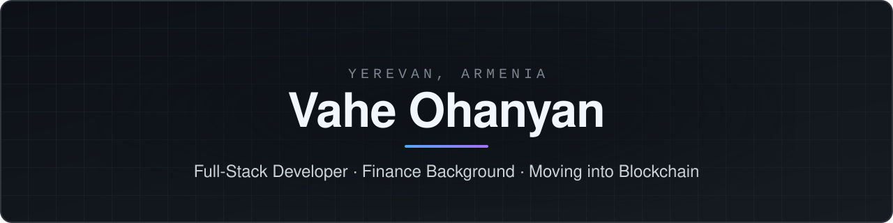

<picture>
  <source media="(prefers-color-scheme: dark)" srcset="./assets/banner-dark.svg" />
  <source media="(prefers-color-scheme: light)" srcset="./assets/banner-light.svg" />
  
</picture>

  <a href="https://www.linkedin.com/in/vahe-ohanyan-352165328/"><picture><source media="(prefers-color-scheme: dark)" srcset="./assets/social/linkedin-dark.svg" /><source media="(prefers-color-scheme: light)" srcset="./assets/social/linkedin-light.svg" /></picture></a>
  <a href="https://medium.com/@ohanyanv703"><picture><source media="(prefers-color-scheme: dark)" srcset="./assets/social/medium-dark.svg" /><source media="(prefers-color-scheme: light)" srcset="./assets/social/medium-light.svg" /></picture></a>
  <a href="https://t.me/Vahe1O"><picture><source media="(prefers-color-scheme: dark)" srcset="./assets/social/telegram-dark.svg" /><source media="(prefers-color-scheme: light)" srcset="./assets/social/telegram-light.svg" /></picture></a>
  <a href="https://leetcode.com/u/Vahe_1"><picture><source media="(prefers-color-scheme: dark)" srcset="./assets/social/leetcode-dark.svg" /><source media="(prefers-color-scheme: light)" srcset="./assets/social/leetcode-light.svg" /></picture></a>
  <a href="mailto:ohanyanv703@gmail.com"><picture><source media="(prefers-color-scheme: dark)" srcset="./assets/social/email-dark.svg" /><source media="(prefers-color-scheme: light)" srcset="./assets/social/email-light.svg" /></picture></a>

---

## About

I build full-stack web products with TypeScript, React, and Node.js, and I hold a degree in finance. That mix lets me write the software and understand the business it serves.

I'm now moving into blockchain development, where both sides meet. I care about clean, maintainable code and products that hold up long after launch.

**Open to opportunities.** If you're hiring, building something, or just want to talk, [email me](mailto:ohanyanv703@gmail.com) or message me on [Telegram](https://t.me/Vahe1O).

## Featured Projects

| Project | What it is | Stack |
| --- | --- | --- |
| **[Vahoha](https://github.com/OV111/Vahoha)** · [live](https://vahoha.com) | A development platform I'm building and running in production. | JavaScript |
| **[Stoxly](https://github.com/OV111/Stoxly)** | Real-time stock market platform with live price streaming, smart alerts, interactive charts, AI insights, and market news. | Next.js, TypeScript, Better Auth, Inngest |
| **[Writ](https://github.com/OV111/Writ)** | Authorisation layer for agent-to-agent payments: a policy engine that gates x402 transactions before they're signed. | Solidity |

## Languages & Tools

